# DCF-TimePro: Dual Channel Frequency Enhanced Variable - Time-delayed Super-state Multivariate Time Series Prediction Network

\tPreface  
\tIn the task of multivariate time series prediction, taking photovoltaic power prediction as an example, the input usually includes multiple types of variables such as power, irradiance, environmental temperature, humidity, wind speed, pressure, cloud cover/cloud base height, etc. Traditional Transformers, PatchTST, TCN, or standard MLP mainly focus on temporal dimension patterns, or learn variable relationships using Attention. However, in real photovoltaic systems, there are at least three structural types:  
\t1. \t \t Time-period structure: daily cycles, local fluctuations, seasonal scale changes with distinct frequency differences;  
\t2. \t \t Cross-variable combination structure: power is not determined by a single meteorological variable but rather influenced by multiple meteorological factors together;  
\t3. \t \t Variable-specific delay structure: the effective time for different variables to influence future power is not consistent.
In response to this issue, we propose a multivariate time series prediction network called DCF-TimePro (Dual-Channel Frequency-enhanced Variable–Lag Hyper-State Network for Multivariate Time Series Forecasting). In this model:
1.1 DCF denotes Dual-Channel Frequency, specifically indicating that the model establishes a frequency domain representation simultaneously along both the temporal dimension and the variable/channel dimension.
1.2 TimePro is used to reflect the inspiration of the model's approach in jointly modeling variable relationships and time delays, inspired by the "variable-and-time-aware hyper-state" concept of TimePro. (Applicable to multi-feature datasets)

We also provide detailed materials, instructional documents, and video explanations, including how to replace your own dataset, tutorials on parameter adjustments, and code with detailed comments and parameter introductions:
● Datasets: Power generation data sets from photovoltaic power stations, wind power data sets from wind farms, wind speed data sets, etc.
● Environment framework: Python 3.11, PyTorch 2.1 or above are required to run.
● Model scores: Test set score of 0.97
● Usage objects: Paper requirements, graduation design requirements.
● Code guarantee: Code with detailed comments, ready to run without modification.
DCF-TimePro is a three-dimensional collaborative modeling network for complex multivariate time series prediction. The model first divides the raw historical sequence into local time patches and establishes variable identity representations; subsequently, two complementary frequency modeling branches are constructed: one performs frequency transformation along the time/Patch dimension to capture periodicity and multiscale temporal dynamics; the other performs frequency transformation along the variable dimension to describe the combined frequency structure among multiple variables. 

The two frequency branches fuse with the original Patch representation through adaptive gating. 

After completing dual-frequency representation, the model enters the Variable-Lag Hyper-State Block. This module first scans along the variable dimension, spreading contextual information of different variables to each variable state; then, explicit Lag Banks are established for each variable, automatically selecting key historical lags through learnable Lag-aware Time Tune, thereby constructing hyper-states that simultaneously contain cross-variable relationships and variable-specific temporal information. Finally, the target variable's hyper-state is extracted and multi-step future mapping is completed.

1.2 Model Innovation Points
Innovation Point 1: Dual-Channel Frequency Modeling (Dual-Channel Frequency Modeling)
Traditional frequency domain prediction usually analyzes periodicity only along the time dimension, but multivariate prediction also involves complex cross-variable combination relationships. Simply performing frequency decomposition along the time dimension cannot directly depict the structural patterns on the variable axis. DCF-TimePro simultaneously establishes both temporal-frequency patterns and channel-frequency patterns, enabling the model to not only focus on time-frequency structures such as periodicity, trend, and rapid fluctuations but also express cross-variable combination patterns from the frequency domain perspective.
Innovation Point 2: Adaptive Dual-Frequency Gated Fusion (DCF-TimePro) Learning
The DCF-TimePro learns to adaptively fuse weights that vary with samples, variables, and Patch positions, allowing the model to dynamically choose based on the current state:
- More reliant on local raw time domain features;
- More reliant on periodic/time-frequency features;
- More reliant on cross-variable frequency structure.
At the same time, [Wo, WT, Wc] can be directly used for interpretability analysis.
Innovation Point 3: Variable-Specific Lag-Aware Time Tune
Different variables in a multivariate sequence may have different optimal historical role intervals. A unified time weight cannot fully describe the phenomenon of multi-delay. Through Lag-aware Time Tune, each variable is dynamically selected for key historical delays, which is more fine-grained than global uniform Lag, fixed window pooling, or ordinary time averaging. Moreover, the Lag weight matrix can be used for analyzing "which variable mainly relies on how far into the past," offering strong interpretability.
Introduction to Electric Power Transformer Dataset
2.1 Import Data
The photovoltaic power generation dataset consists of 2053 samples with 8 features, visualized as follows:
2.2 Data Preparation and Preprocessing
Details are provided in the document provided!
High-Innovative Prediction Model Based on DCF-TimePro
3.1 Define the DCF-TimePro prediction network model
3.2 Set parameters and train the model
50 epochs, MSE is 0.00915, DCF-TimePro prediction effect is significant. Simultaneously, frequency modeling is performed in both time and variable dimensions to capture multi-scale temporal dynamics and cross-variable combination frequency structures. Subsequently, an adaptive gating mechanism integrates raw representations, time-frequency representations, and variable-frequency representations. Building on this, the model utilizes Variable Scan to propagate global variable contexts and Lag-aware Time Tune to dynamically select critical historical lags for each variable, ultimately constructing a Hyper-State that encompasses frequency structure, variable dependencies, and variable-specific temporal delays, thereby achieving more accurate, stable, and interpretable power forecasting for photovoltaic power generation.
4 Results Visualization and Model Evaluation
4.1 Model Evaluation
4.2 Visualization of Prediction Results
(1) Dataset 1: Wind Power Data Set for Wind Farms
\t  
(2) Dataset 2: Photovoltaic Power Generation Power Data Set
4.3 Solvability Analysis
(1) Adaptive Fusion Weights
The three-way fusion weights indicate that DCF-TimePro does not perform a fixed proportion fusion of the original representation, time-frequency representation, and variable-frequency representation. Instead, it forms differentiated information selection patterns for different variables. For total irradiance, normal irradiance, scattering irradiance, temperature, plate temperature, and power, the time-frequency branch receives higher weights, with the time-frequency weight for plate temperature reaching 0.419, indicating that its prediction representation is more reliant on temporal dynamic features. In contrast, the humidity variable exhibits a distinctly different fusion pattern, with its variable-frequency weight reaching 0.435, which is higher than the time-frequency weight of 0.331, suggesting that cross-variable frequency interaction contributes more to modeling humidity-related information. Furthermore, the original representation weights for each variable are only between 0.217–0.261, while the total contribution from the dual-frequency enhanced representation is approximately 0.74–0.78, further demonstrating that dual-frequency modeling plays a dominant role in the final feature formation process.
\t  
1. Different Blocks' Variable Delay Evolution
The analysis of delay in different Hyper-State Blocks further shows that the average historical delay for each variable increases slightly in deeper Blocks, indicating that the network gradually expands its scope of utilizing historical context as it updates states. Among them, humidity maintains a relatively high average delay, while scattering irradiance exhibits more significant time delay adjustments across different Blocks. However, the absolute difference in average delays remains small, making this result more suitable for explaining fine-grained preference for delay rather than a significant separation of temporal delay patterns.
CF-TimePro employs a three-dimensional collaborative modeling approach combining "time frequency + variable frequency + variable specific delay" to elevate traditional multivariate prediction from purely time-dependent learning to joint modeling of frequency, variable relationships, and historical delays. It utilizes interpretable dual-frequency Gates and Lag weights to construct Variable-Lag Hyper-States for multi-step predictions. This provides a more structured priori and interpretable deep learning framework for multivariate non-stationary time series prediction tasks. Not only applicable to photovoltaic power prediction, but also extends to transformer oil temperature prediction, power load prediction, equipment status prediction, and wind power power prediction among other multivariate time series prediction tasks.
Previously interesting content:
Informer prediction model collection: New feature importance analysis!
Fast Fourier Transform violent growth points! A high-innovation time series classification model based on time-frequency feature fusion
STL-VMD secondary decomposition + Informer-LSTM parallel prediction model
Continued updates! Attention mechanism + lithium battery remaining life prediction collection
Direct writing! CEEMDAN decomposition + Informer-LSTM +XGBoost combined prediction model
Comparative collection of photovoltaic power generation forecasting models based on Informer-SENet! Six sets of comparative forecasting models, directly written for graduation thesis or minor thesis!
Highly innovative model for predicting the remaining lifespan of lithium batteries using ICEEMDAN+SHAP for explainability analysis!
Predictive model based on Informer-BiGRUGATT-CrossAttention.
Highly innovative! Comprehensive predictive model based on ICEEMDAN+MSCNN-BiGRU-Attention.
Novel prediction model for air quality PM2.5 concentration! Comprehensive predictive model based on VMD rolling decomposition + attention mechanism.
End.
\t2. Friends who like this can click to follow, give the article a "like", share it in WeChat Moments or discuss groups.

## Images

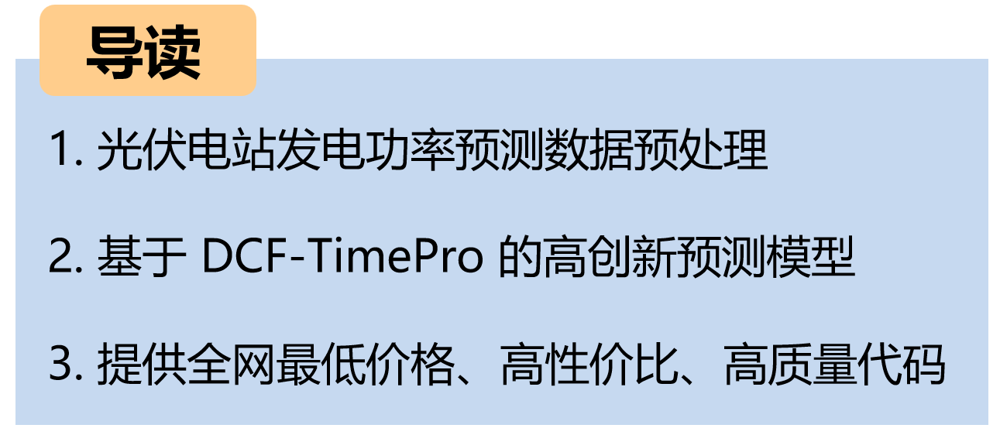
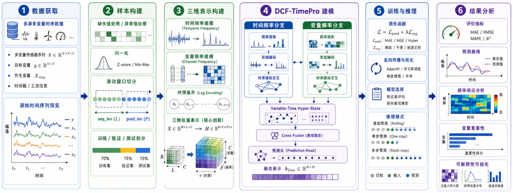

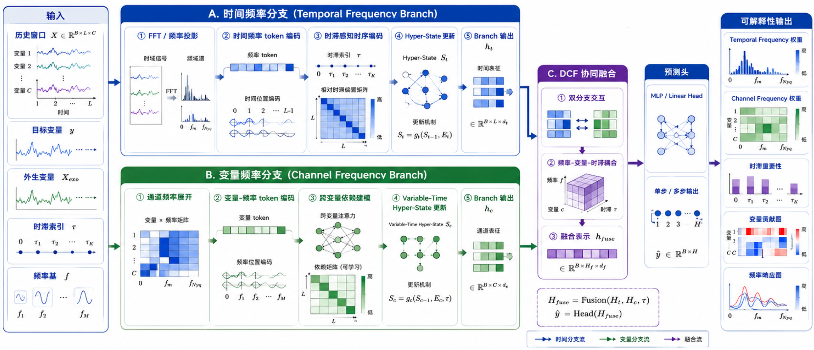
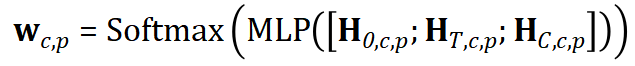
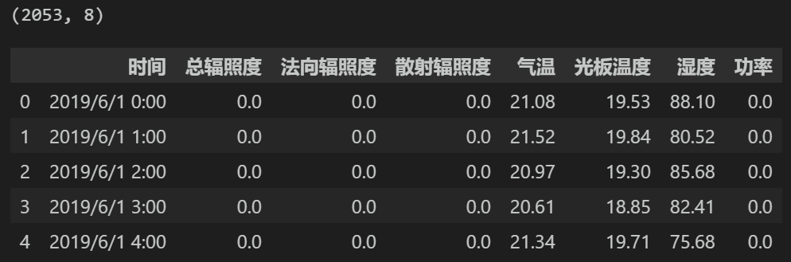
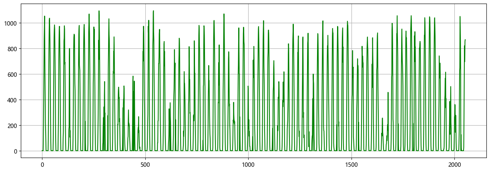
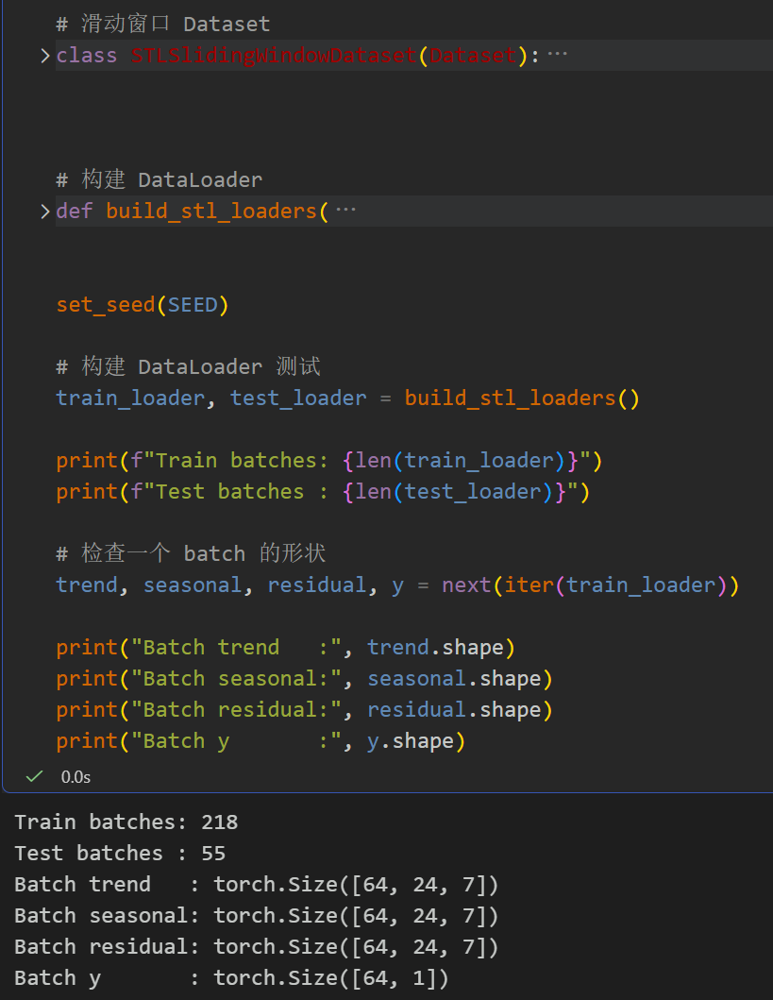
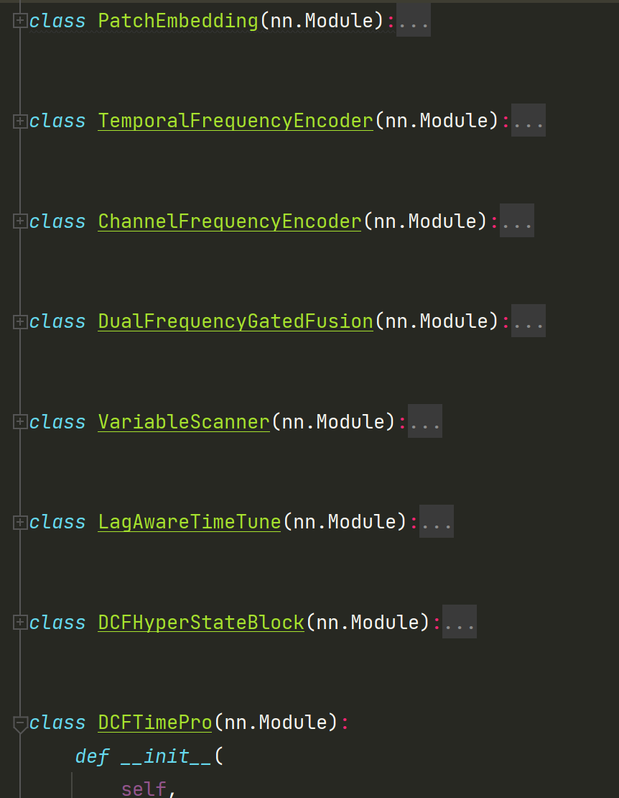
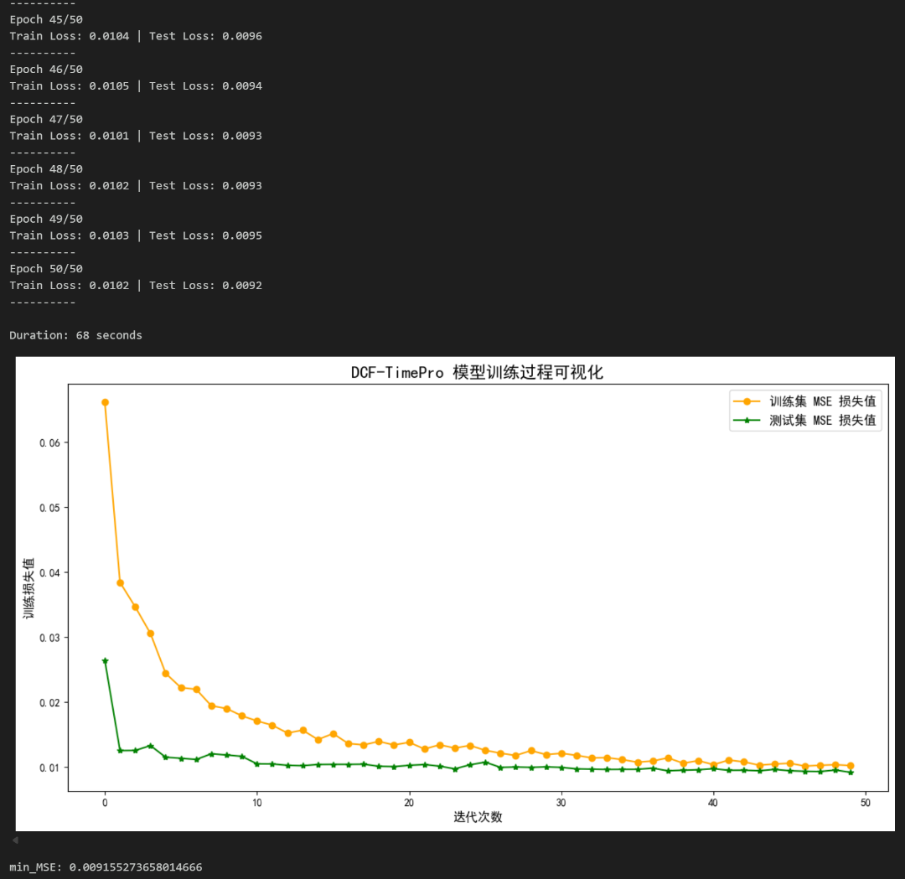
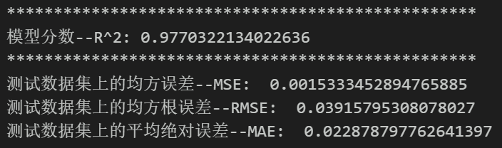
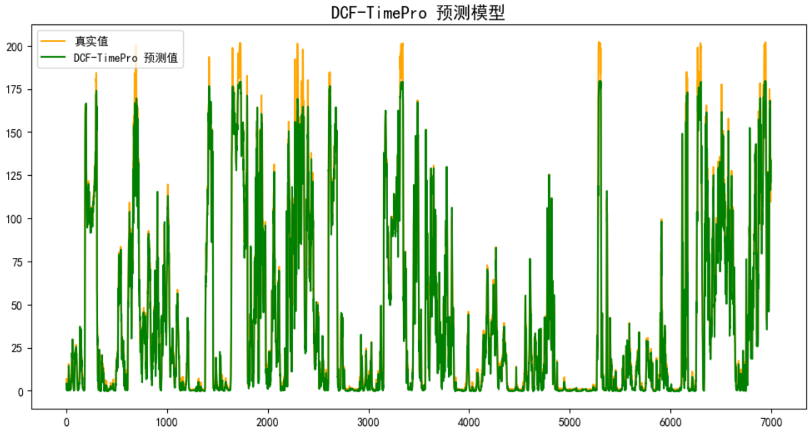
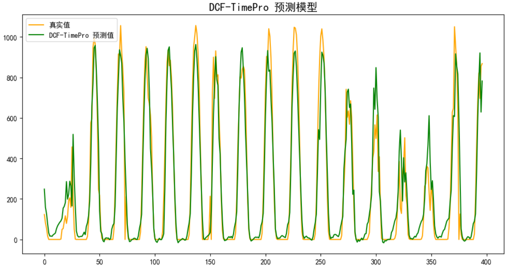
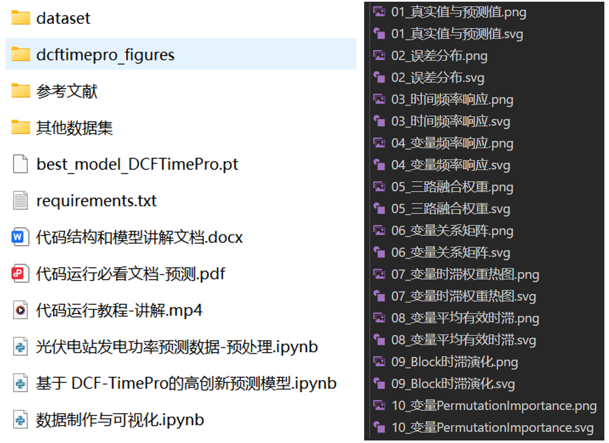

<!-- PAYMENT_BLOCK -->

## Get this dataset

- Payment link (Stripe): [Buy now](https://buy.stripe.com/3cs8yP7sY87d0vu9AB)
- Payment QR code: 

<!-- /PAYMENT_BLOCK -->
